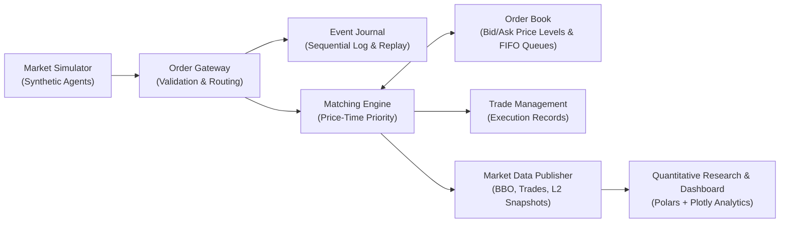

# Martingale Exchange

**High-Performance Electronic Trading Exchange & Quantitative Research Platform**

[](https://en.cppreference.com/w/cpp/20)
[](https://cmake.org/)
[](https://www.kernel.org/)

---

## Overview

**Martingale Exchange** is a deterministic, low-latency simulated electronic exchange, limit order book (LOB), matching engine, synthetic market simulation framework, and quantitative microstructure research platform written in **C++20** and **Python 3**.

This project is engineered around real-world quantitative trading infrastructure principles:
- **Deterministic Execution:** Identical ordered input command sequences strictly produce identical trade executions and order book states.
- **Exact Tick Arithmetic:** Integer price ticks and integer quantities throughout the critical matching path—zero IEEE-754 floating-point rounding ambiguity.
- **Hardware-Conscious Design:** Separation of the critical single-threaded matching path from journaling and market data publication, evolving from a clean STL baseline (`std::map`, `std::list`, `std::unordered_map`) to pre-allocated object pools and cache-friendly intrusive structures guided by hardware performance counters (`perf`, cache misses, branch mispredictions).
- **End-to-End Quantitative Pipeline:** Multi-agent synthetic market simulation producing tick-by-tick L1/L2 feeds for microstructure analysis (spread dynamics, book imbalance, VWAP, realized volatility, execution slippage, and market impact) visualised in a `Polars` + `Plotly` research dashboard.

---

## System Architecture



### Core Components

| Component | Responsibility |
| :--- | :--- |
| **Order Gateway** | Validates incoming order fields, instrument identifiers, and order IDs before dispatching commands to the matching engine. |
| **Matching Engine** | Executes Limit, Market, and Cancel commands under strict price-time (FIFO) priority across single and multiple instruments. |
| **Order Book** | Maintains Bid and Ask price levels, FIFO order queues, aggregate level quantities, and $O(1)$ order lookup registries. |
| **Trade Management** | Emits sequenced execution records (`TradeId`, `InstrumentId`, execution price/qty, resting & aggressing `OrderId`s). |
| **Event Journal** | Sequentially records accepted commands and exchange events for deterministic state reconstruction and debugging replay. |
| **Market Data Publisher** | Publishes order lifecycle events, trade prints, Best Bid/Offer (BBO) updates, and L2 order book snapshots off the critical path. |
| **Performance Framework** | Measures throughput (orders/sec), latency percentiles (P50, P90, P95, P99, P99.9, Max), CPU cycles, cache misses, and branch mispredictions. |
| **Market Simulator & Quant Research** | Simulates Market Makers, Momentum, Random, and Institutional traders to analyse spread, book imbalance, VWAP, volatility, and market impact. |

---

## Repository Structure

```text
martingale-exchange/
├── include/
│   └── martingale/       # Public C++20 headers (types, book, engine, gateway, journal, md)
├── src/                  # C++20 implementation files
├── tests/                # GoogleTest unit, integration, and determinism tests
├── benchmarks/           # Google Benchmark suites and latency/hardware profiling harnesses
├── python/               # Polars + Plotly quantitative research & interactive dashboard
├── docs/                 # Architecture Decision Records (ADRs), Doxygen config, and notes
└── CMakeLists.txt        # Root CMake configuration
```

---

## Technology Stack

- **Core Systems:** C++20, CMake, Ninja, GCC 15 / Clang 21 (Linux)
- **Testing & Verification:** GoogleTest, AddressSanitizer (ASan), UndefinedBehaviorSanitizer (UBSan)
- **Performance & Profiling:** Google Benchmark, Linux `perf`, Valgrind, Heaptrack
- **Quantitative Analytics & Visualisation:** Python 3, NumPy, Polars, Plotly, `pybind11`

---

## 12-Week Development Roadmap

| Milestone | Timeframe | Focus Areas |
| :--- | :--- | :--- |
| **Milestone 1** | Weeks 1–2 | Environment setup, CMake/Ninja toolchain, GoogleTest, foundational fixed-point types (`Order`, `Trade`) |
| **Milestone 2** | Weeks 3–4 | Single-instrument `OrderBook`, Limit/Market matching, cancellations, partial fills, matching test suite |
| **Milestone 3** | Weeks 5–6 | Multi-instrument routing, `OrderGateway`, sequential `EventJournal`, deterministic replay, `MarketDataPublisher` |
| **Milestone 4** | Weeks 7–8 | Google Benchmark suite, latency percentiles, CPU/memory profiling (`perf`, Heaptrack), custom memory pools & intrusive containers |
| **Milestone 5** | Weeks 9–10 | Synthetic market participant simulator, market microstructure metrics, reproducible quantitative experiments |
| **Milestone 6** | Weeks 11–12 | Python (`Polars` + `Plotly`) interactive dashboard, Doxygen & ADR documentation, final verification |
