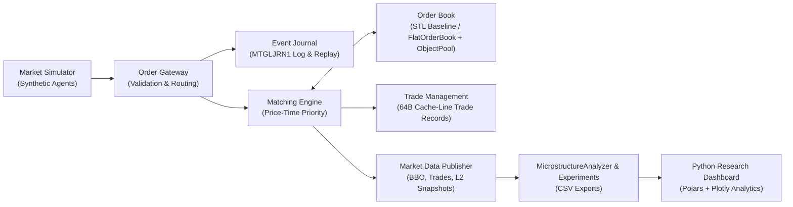

# Martingale Exchange

**High-Performance Electronic Trading Exchange & Quantitative Research Platform**

[](https://en.cppreference.com/w/cpp/20)
[](https://cmake.org/)
[](https://www.kernel.org/)
[](https://martingale-exchange.onrender.com/)

> **Live App:** **[https://martingale-exchange.onrender.com/](https://martingale-exchange.onrender.com/)** · **6 / 6 Milestones Completed** (`#1`–`#24` closed) · **`64 / 64` GoogleTest suites** passing under GCC 15 (`-O3`) and Clang 21 (`Debug + ASan/UBSan`) · **`5 / 5` `pytest` checks** passing · Zero-warning **Doxygen 1.15** docs · Explore the **[Project Wiki](https://github.com/uzansar/martingale/wiki)**.

---

## Overview

**Martingale Exchange** is a deterministic, low-latency simulated electronic exchange, limit order book (LOB), matching engine, synthetic market simulation framework, and quantitative microstructure research platform written in **C++20** and **Python 3 (`Polars` + `Plotly`)**.

This project is engineered around real-world quantitative trading infrastructure principles:
- **Deterministic Execution:** Identical ordered input command sequences strictly produce identical trade executions, sequence numbers, and order book states across both the STL oracle and optimized matching paths.
- **Exact Tick Arithmetic:** Fixed-point integer prices (`Price = int64_t`) and quantities (`Quantity = uint64_t`) throughout the critical matching path—zero IEEE-754 floating-point rounding ambiguity.
- **Hardware-Conscious Optimization:** Evolves cleanly from a verified STL baseline (`OrderBook`) to a pre-allocated `ObjectPool<IntrusiveOrderNode>` and contiguous `FlatOrderBook` (`FastMatchingEngine`) guided by Google Benchmark histograms, Callgrind cache/branch simulation, and Heaptrack.
- **End-to-End Quantitative Pipeline:** Seeded multi-agent market simulations (`MarketSimulator`) routed through the exchange core produce tick-by-tick BBO, execution tape, and L2 snapshot CSV datasets evaluated by `MicrostructureAnalyzer` and visualized via a 6-panel interactive `Polars` + `Plotly` research dashboard.

---

## System Architecture



### Core Components

| Component | Responsibility |
| :--- | :--- |
| **Order Gateway** | Validates incoming order fields, instrument IDs, and order IDs before dispatching commands to the matching engine. |
| **Matching Engine** | Executes Limit, Market, and Cancel commands under strict price-time (FIFO) priority across single and multiple instruments (`MatchingEngine` / `FastMatchingEngine`). |
| **Order Book** | Maintains descending Bid and ascending Ask price levels, FIFO queues, aggregate level quantities, and $O(1)$ order lookup registries (`OrderBook` STL baseline and pooled `FlatOrderBook`). |
| **Trade Management** | Emits cache-line-aligned (`64 B`) sequenced execution records (`TradeId`, `InstrumentId`, execution price/qty, buyer & seller `OrderId`s). |
| **Event Journal & Replay** | Sequentially records accepted commands and exchange events in binary `MTGLJRN1` format for deterministic `ReplayEngine` state reconstruction. |
| **Market Data Publisher** | Publishes order lifecycle events, trade prints, L1 BBO updates (`BboQuote`), and configurable-depth L2 snapshots off the critical path. |
| **Performance Framework** | Tracks throughput (`ops/sec`) and tail latencies (`Mean`, `P50`, `P90`, `P95`, `P99`, `P99.9`, `Max`) alongside Google Benchmark JSON exports. |
| **Market Simulator & Quant Research** | Runs deterministic `std::mt19937_64` simulations (`MarketMaker`, `Random`, `Momentum`, `Institutional` agents), computes microstructure metrics, and feeds the 6-panel `Polars` + `Plotly` dashboard. |

---

## Measured Performance & Microstructure Highlights

### Engine Optimization (`GCC 15.2.0 -O3`, Linux x86_64)

Full reports: [`docs/benchmark_comparison.md`](docs/benchmark_comparison.md) · [`docs/benchmark_baseline.md`](docs/benchmark_baseline.md) · [ADR-005](docs/ADR-005-object-pool-and-flat-order-book.md)

| Workload | STL Baseline | `ObjectPool` + `FlatOrderBook` | P50 Latency | P99 Latency | Speedup |
| :--- | ---: | ---: | ---: | ---: | ---: |
| **Add & Cancel** | `21.17 M/s` | **`86.71 M/s`** | `57 ns` → **`29 ns`** | `81 ns` → **`40 ns`** | **`4.10x`** |
| **Resting Limits** | `10.56 M/s` | **`20.26 M/s`** | `62 ns` → **`39 ns`** | `175 ns` → **`70 ns`** | **`1.92x`** |
| **Crossing Limits** | `13.02 M/s` | **`24.26 M/s`** | `77 ns` → **`54 ns`** | `230 ns` → **`92 ns`** | **`1.86x`** |
| **Mixed 10k Sim** | `7.80 M/s` | **`11.90 M/s`** | `95 ns` → **`62 ns`** | `801 ns` → **`774 ns`** | **`1.53x`** |

- **Callgrind Deltas (`MixedWorkload_10k`):** `-27.0%` instructions, `-28.0%` D1 read misses, `-42.7%` branch mispredictions, and `-85.8%` indirect branch mispredictions.
- **25k-Command Stress Parity:** `EndToEndStressTest.MultiInstrumentGatewayJournalReplayAndFastEngineParity` verifies exact trade, L2 snapshot, and `MTGLJRN1` binary replay parity across `MatchingEngine` and `FastMatchingEngine` under ASan + UBSan.

### Microstructure Experiments (`seed = 2026`, `500` steps)

Full report: [`docs/microstructure_experiments.md`](docs/microstructure_experiments.md) · [ADR-006](docs/ADR-006-seeded-market-simulator-and-decoupled-analytics.md)

- **Institutional Order Size (`100` → `1,500` Buy shares):** Execution slippage scales monotonically from **`15.93 bps`** to **`27.65 bps`** (**`+73.6%`**), with transient execution pressure reaching **`35.67 bps`**.
- **Market Maker Half-Spread (`1` → `4` ticks):** Mean realized BBO spread widens monotonically (**`2.56`** → **`4.27 bps`**) while traded volume contracts **`9.2%`** (`78,240` → `71,003` shares).
- **Momentum Participation (`0` → `5` agents):** Induces endogenous volatility clustering—realized volatility surges **`7.0x`** (**`1.55`** → **`10.86 bps`**) with **`+148%`** higher volume and **`+89.5%`** wider spreads.

---

## Documentation & Architecture Decision Records

- [`docs/README.md`](docs/README.md) — Documentation hub and report index
- [ADR-001: Fixed-Point Arithmetic](docs/ADR-001-fixed-point-arithmetic.md)
- [ADR-002: STL Baseline Order Book](docs/ADR-002-stl-baseline-order-book.md)
- [ADR-003: Single-Threaded Deterministic Matching](docs/ADR-003-single-threaded-deterministic-matching.md)
- [ADR-004: Binary Sequential Event Journal & Replay](docs/ADR-004-binary-event-journal-and-deterministic-replay.md)
- [ADR-005: Pre-Allocated ObjectPool & FlatOrderBook](docs/ADR-005-object-pool-and-flat-order-book.md)
- [ADR-006: Seeded Market Simulator & Decoupled Analytics](docs/ADR-006-seeded-market-simulator-and-decoupled-analytics.md)

---

## Repository Structure

```text
martingale-exchange/
├── include/
│   └── martingale/
│       ├── book/         # OrderBook, PriceLevel (STL baseline) & FlatOrderBook
│       ├── core/         # Fixed-point domain primitives, Order (48B), Trade (64B)
│       ├── engine/       # BasicMatchingEngine (MatchingEngine & FastMatchingEngine)
│       ├── gateway/      # OrderGateway validation & multi-instrument routing
│       ├── journal/      # Sequential binary EventJournal (MTGLJRN1) & ReplayEngine
│       ├── market_data/  # MarketDataPublisher (BBO deltas & L2 snapshots)
│       ├── performance/  # ObjectPool slab allocator & LatencyRecorder percentiles
│       ├── research/     # MicrostructureAnalyzer metrics & CSV exporters
│       └── simulator/    # Seeded MarketSimulator & synthetic trading agents
├── src/
│   └── run_experiments.cpp # CLI running parameter sweeps & parameterized --single-run simulations
├── tests/                # GoogleTest suite (64 tests across unit, replay, sim & stress)
├── benchmarks/           # Google Benchmark suites (STL baseline vs. FastMatchingEngine)
├── python/               # Polars pipeline (data_pipeline.py), Plotly dashboard, Streamlit app (app.py) & pytest
├── docs/                 # ADR-001..006, benchmark reports & microstructure findings
├── Dockerfile            # Multi-stage C++20 builder + Python 3.12 Streamlit runtime container
├── render.yaml           # Render cloud blueprint for one-click Docker web deployment
├── Doxyfile              # Zero-warning Doxygen HTML documentation configuration
└── CMakeLists.txt        # Root CMake configuration (C++20, GCC/Clang, ASan/UBSan)
```

---

## Quick Start (Build, Test, Benchmarks, Dashboard & Doxygen)

```bash
# 1. Configure & build Release (Tests, Benchmarks, Experiments CLI)
cmake -B build/gcc-release -G Ninja \
  -DCMAKE_BUILD_TYPE=Release \
  -DMARTINGALE_BUILD_TESTS=ON \
  -DMARTINGALE_BUILD_BENCHMARKS=ON
cmake --build build/gcc-release
ctest --test-dir build/gcc-release --output-on-failure

# 2. Configure & verify Clang Debug with AddressSanitizer + UndefinedBehaviorSanitizer
cmake -B build/clang-san -G Ninja \
  -DCMAKE_CXX_COMPILER=clang++ \
  -DCMAKE_BUILD_TYPE=Debug \
  -DMARTINGALE_ENABLE_ASAN=ON \
  -DMARTINGALE_ENABLE_UBSAN=ON
cmake --build build/clang-san
ctest --test-dir build/clang-san --output-on-failure

# 3. Export Google Benchmark JSON & Microstructure CSV Datasets
./build/gcc-release/benchmarks/martingale_benchmarks \
  --benchmark_min_time=0.2s \
  --benchmark_out=data/processed/benchmarks.json \
  --benchmark_out_format=json
./build/gcc-release/martingale_experiments --export-dir data/processed

# 4. Run Python Polars/Plotly Verification Suite & Build Interactive HTML Dashboard
python -m venv .venv
.venv/bin/python -m pip install -r python/requirements.txt   # On Windows: .venv\Scripts\python
.venv/bin/python -m pytest python/test_dashboard.py -v
.venv/bin/python python/dashboard.py --data-dir data/processed --output data/processed/martingale_dashboard.html

# 5. Build Zero-Warning Doxygen API Reference (outputs to docs/html/index.html)
doxygen Doxyfile
```

---

## Live Interactive Web App & Cloud Deployment

**Live Deployment:** **[https://martingale-exchange.onrender.com/](https://martingale-exchange.onrender.com/)**

Launch the interactive web simulator (`python/app.py`) powered live by the compiled C++20 matching engine (`martingale_experiments --single-run`), `Polars`, and `Plotly`:

```bash
# Run locally with Streamlit (invokes native C++ binary, or WSL2 automatically on Windows)
.venv/bin/python -m streamlit run python/app.py

# Or build and run the standalone multi-stage Docker container
docker build -t martingale-exchange .
docker run -p 8501:8501 martingale-exchange
```

- **One-Click Cloud Deploy (Render):** Connect the repository to **Render** as a Blueprint using `render.yaml` (`runtime: docker`, `plan: free`, `healthCheckPath: /_stcore/health`, `autoDeploy: true`).
- **Portable Container:** Because the `Dockerfile` binds `0.0.0.0:${PORT:-8501}`, the same image deploys directly to **Fly.io**, **Railway**, or **Google Cloud Run** with zero code changes.

---

## Technology Stack

- **Core Systems:** C++20, CMake, Ninja, GCC 15 / Clang 21 (Linux)
- **Testing & Verification:** GoogleTest (`64/64` tests), CTest, AddressSanitizer (ASan), UndefinedBehaviorSanitizer (UBSan), `pytest` (`5/5` tests), GitHub Actions CI
- **Performance & Profiling:** Google Benchmark, Valgrind (`callgrind`), Heaptrack, `perf stat`
- **Quantitative Analytics, Web & Docs:** `MicrostructureAnalyzer` (C++20 CSV exports), Python 3 (`Polars`, `NumPy`, `Plotly`, `Streamlit`), Docker, Render (`render.yaml`), Doxygen `1.15`

---

## 12-Week Development Roadmap

| Milestone | Timeframe | Status | Focus Areas | Issues |
| :--- | :--- | :--- | :--- | :--- |
| **Milestone 1** | Weeks 1–2 | **Completed** | Environment setup, CMake/Ninja toolchain, GitHub Actions CI, GoogleTest, core fixed-point types (`Order`, `Trade`) | `#1` – `#5` |
| **Milestone 2** | Weeks 3–4 | **Completed** | Single-instrument `OrderBook`, Limit/Market matching, cancellations, partial fills, matching & determinism test suite | `#6` – `#9` |
| **Milestone 3** | Weeks 5–6 | **Completed** | Multi-instrument routing, `OrderGateway`, binary `EventJournal`, `ReplayEngine`, decoupled `MarketDataPublisher` | `#10` – `#13` |
| **Milestone 4** | Weeks 7–8 | **Completed** | Google Benchmark suite, latency percentiles, CPU/memory profiling, pre-allocated `ObjectPool` & `FlatOrderBook` | `#14` – `#17` |
| **Milestone 5** | Weeks 9–10 | **Completed** | Deterministic `MarketSimulator`, synthetic trading agents, `MicrostructureAnalyzer` metrics & reproducible experiments | `#18` – `#21` |
| **Milestone 6** | Weeks 11–12 | **Completed** | Python (`Polars` + `Plotly`) interactive dashboard, Doxygen `1.15`, ADR-004–006 & 25k-order stress/sanitizer audit | `#22` – `#24` |
